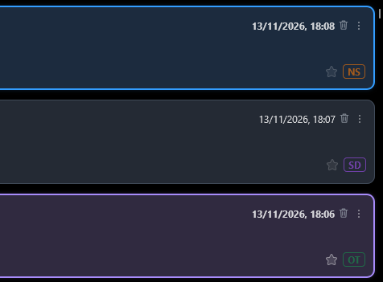
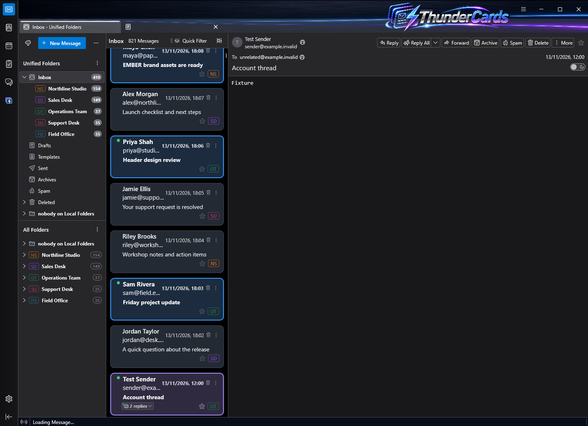

# ThunderCards

A modern, customisable Cards View and dark theme for Mozilla Thunderbird.

[Download ThunderCards 1.7.19](https://github.com/Econut/ThunderCards/releases/tag/v1.7.19) · [Report an issue](https://github.com/Econut/ThunderCards/issues)

## What ThunderCards adds

- **Cards View** puts the sender name, email address and subject on separate lines. Blue borders and green dots identify unread messages, grey borders identify read messages, and purple identifies the selection.
- **Account badges** use editable initials and colours in Unified Folders, All Folders and combined message lists. ThunderCards detects supported accounts as you add them in Thunderbird.
- **Quick Delete** adds a trash button beside the card menu where Thunderbird can safely move the message to Trash. After deleting a selected single message, ThunderCards prefers the next visible message, or the previous one at the end of the list.
- **ThunderCards theme** adds the full-width blue and purple lightning header. The theme can be turned off in Settings.
- **Restore Last Email on Startup** is optional and off by default. It restores the last selected read email in the main mail tab when the reading pane is visible. Unread and unavailable messages are skipped.

## Settings and menus

Click the **ThunderCards lightning icon** in the left Spaces toolbar to open Settings. You can also use **Add-ons and Themes → Extensions → ThunderCards → Preferences**. In the folder pane, right-click a supported account badge and choose **Edit account badge** to open its settings.

| Section | Controls |
| --- | --- |
| Appearance | Enable or disable the ThunderCards theme. |
| Startup | Turn last-email restoration on or off. |
| Account badges | Select an account, edit its two-letter label and colour, preview the badge, then save or reset it. |
| About ThunderCards | Check the installed version and open the GitHub repository or issue tracker in your default browser. |

## More screenshots

All screenshots are from a disposable Thunderbird profile with sample messages.

### Unified Folders and All Folders

Outlined badges identify accounts in the folder pane. Muted folder icons and unread counts keep the hierarchy easy to scan.

### Message-card controls

The right edge of each card shows the date, Quick Delete and the native three-dot menu. Stars and account badges sit below.

### Individual Inbox and reading pane

### Threaded conversation

## Install or upgrade

1. Download the XPI from the [1.7.19 release](https://github.com/Econut/ThunderCards/releases/tag/v1.7.19).
2. In Thunderbird 160.x, open **Add-ons and Themes → Extensions**.
3. Open the gear menu, choose **Install Add-on From File**, and select the downloaded XPI.
4. Select **Cards View** in the message list.

The add-on keeps its existing ID for upgrades and bundles its own styles. It uses a Thunderbird Experiment restricted to Thunderbird 160.x.

## Build and rollback

Run `./build.ps1` from the repository root in PowerShell to package `addon/` into a versioned XPI in `dist/`.

To remove the header theme, turn off **Enable ThunderCards Theme**. To restore Thunderbird's native cards and folder styles, disable ThunderCards in **Add-ons and Themes → Extensions**. To roll back to an earlier build, install its XPI using **Install Add-on From File**.
