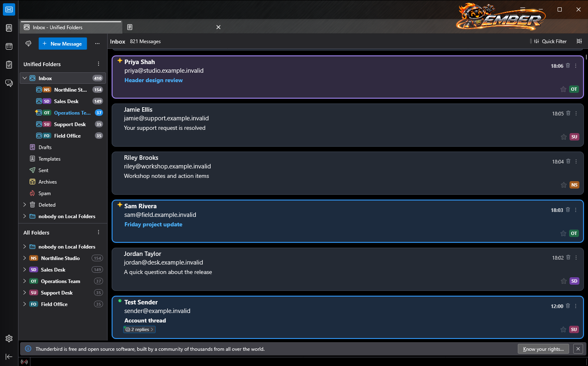
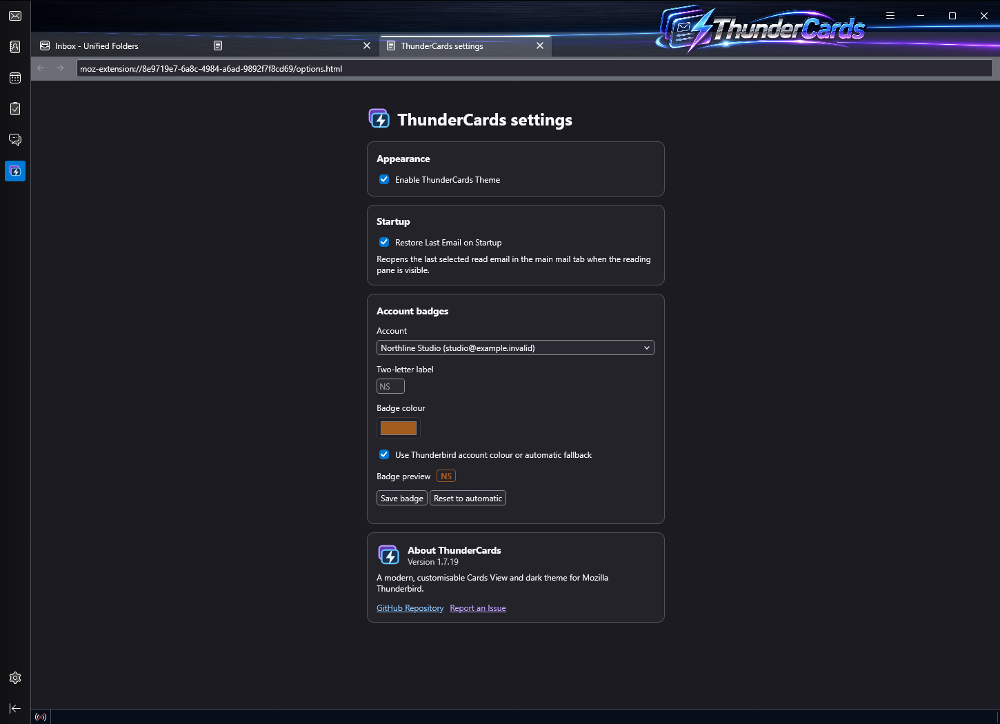
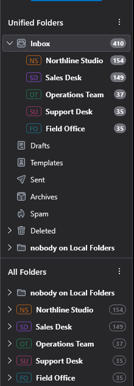
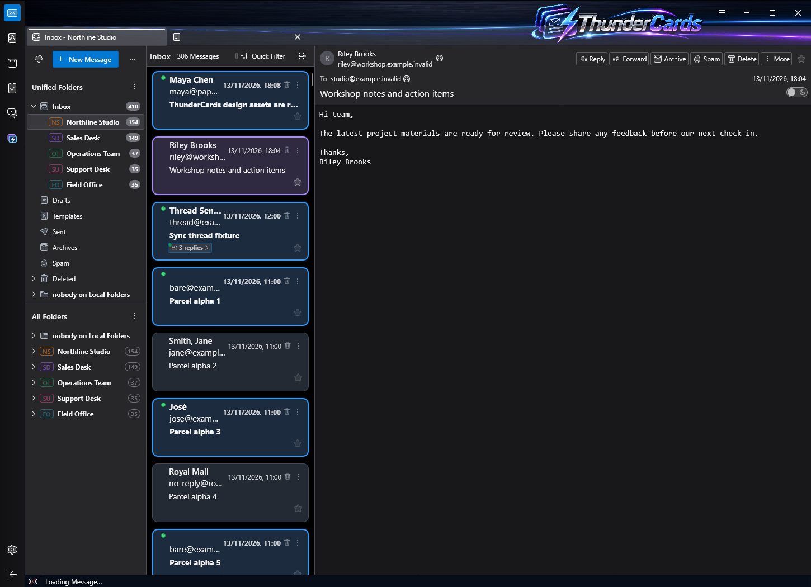

  

A modern, customisable Cards View and dark theme for Mozilla Thunderbird.

**Compatibility:** Thunderbird 160.x · Tested on Windows with Thunderbird 160.0

**Features:** Customisable account badges · Optional dark theme

[Download ThunderCards 1.7.24](https://github.com/Econut/ThunderCards/releases/tag/v1.7.24) · [Report an issue](https://github.com/Econut/ThunderCards/issues)

## What ThunderCards adds

- **Cards View** puts the sender name, email address and subject on separate lines. Blue borders and green dots identify unread messages, grey borders identify read messages, and purple identifies the selection.
- **Account badges** use editable initials and colours in Unified Folders, All Folders and combined message lists. ThunderCards detects supported accounts as you add them in Thunderbird.
- **Quick Delete** adds a trash button beside the card menu where Thunderbird can safely move the message to Trash. After deleting a selected single message, ThunderCards prefers the next visible message, or the previous one at the end of the list.
- **ThunderCards theme** adds the full-width blue and purple lightning header. The theme also darkens and centres global search over the Cards View column and softens the remote-content warning. It can be turned off in Settings.
- **Restore Last Email on Startup** is optional and off by default. It restores the last selected read email in the main mail tab when the reading pane is visible. Unread and unavailable messages are skipped.

## Settings and menus

**Grouped new-email notifications** are optional and off by default. Combine mail across accounts into one total-count notification and one configured mail sound after a 3, 5, 10 or 15-second quiet period (default 5). Thunderbird's existing sound and desktop-alert preferences and its Windows Do Not Disturb check are respected. RSS keeps its native behaviour. Turn grouping off to resume native mail notifications; original notification preferences are never changed.

Click the **ThunderCards lightning icon** in the left Spaces toolbar to open Settings. You can also use **Add-ons and Themes → Extensions → ThunderCards → Preferences**. In the folder pane, right-click a supported account badge and choose **Edit account badge** to open its settings.

| Section | Controls |
| --- | --- |
| Appearance | Enable or disable the ThunderCards theme. |
| Startup | Turn last-email restoration on or off. |
| Notifications | Enable grouped new-email notifications and choose the quiet period. |
| Account badges | Select an account, edit its two-letter label and colour, preview the badge, then save or reset it. |
| About ThunderCards | Check the installed version and open the GitHub repository or issue tracker in your default browser. |

## More screenshots

All screenshots are from a disposable Thunderbird profile with sample messages.

### Unified Folders and All Folders

Outlined badges identify accounts in the folder pane. Muted folder icons and unread counts keep the hierarchy easy to scan.

### Message-card controls

The right edge of each card shows the date, Quick Delete and the native three-dot menu. Stars and account badges sit below.

### Individual Inbox and reading pane

### Threaded conversation

## Install or upgrade

1. Download the XPI from the [1.7.24 release](https://github.com/Econut/ThunderCards/releases/tag/v1.7.24).
2. In Thunderbird 160.x, open **Add-ons and Themes → Extensions**.
3. Open the gear menu, choose **Install Add-on From File**, and select the downloaded XPI.
4. Confirm **Add** when prompted. In the mail tab, open **Message list display options** and select **Cards View**.

The add-on keeps its existing ID for upgrades and bundles its own styles. It uses a Thunderbird Experiment restricted to Thunderbird 160.x.

## Automatic updates

Install 1.7.24 once using the XPI. Thunderbird checks the GitHub update feed for subsequent versions and installs them according to its add-on update settings. Keep automatic updates enabled in Add-ons Manager to receive them automatically.

## Privacy

ThunderCards processes message and account information locally in Thunderbird to display senders, account badges and message selection. It does not upload email content or collect telemetry or analytics. Thunderbird checks the GitHub-hosted update feed and downloads new XPIs when add-on updates are enabled. ThunderCards makes no other background requests to external servers. If you click either GitHub link in About, it asks Thunderbird to open that page in your default browser. Thunderbird continues to handle ordinary mail and account connections.

ThunderCards stores the theme toggle in local extension storage. The Thunderbird profile stores the account badge initials and colour overrides, automatically assigned initials and the startup restore toggle. When startup restoration is enabled, it also stores the last selected message’s account/server key, folder and view URIs, message key and Message-ID. Disabling startup restoration clears the saved message reference.

## Known limitations

ThunderCards uses a privileged Thunderbird Experiment to integrate with the folder pane, message cards, and reading pane. It relies on internal Thunderbird APIs that can change, so the manifest restricts installation to Thunderbird 160.x. Windows with Thunderbird 160.0 is the tested environment. macOS, Linux, and other Thunderbird releases are untested.

Startup restoration is limited to eligible read messages in the main mail tab with the reading pane visible. Messages that moved, were deleted or are unavailable are skipped.

## Release verification

| Check | Status |
| --- | --- |
| GitHub 1.7.19 XPI | Verified that the published asset's SHA-256 matches the local XPI and that the packaged manifest version matches the release tag. |
| README screenshots | Verified that all six published images match the local PNG files and that those files decode. GitHub's rendering of this draft has yet to be checked. |
| Install and rollback | Verified first installation of 1.7.19 and rollback to 1.7.18 via Thunderbird's Add-on Manager API in a disposable Windows profile running Thunderbird 160.0. |
| Upgrade settings | Verified that the tested account badge configuration and startup restore preference survived upgrading from 1.7.18 to 1.7.19. Verified that both the off and on theme settings survived the upgrade. With the theme enabled, the saved setting, logo and header background were also verified after a full Thunderbird restart. |
| Manual menus | Walked through Add-ons and Themes → Extensions → Install Add-on From File, confirmed the 1.7.19 XPI was added, and selected Cards View in the message-list menu. The manual install was over an existing copy. First installation and rollback were verified through the Add-on Manager API. |

## Build and rollback

The [1.7.24 notification test report](docs/GROUPED-NOTIFICATIONS.md) distinguishes completed checks from untested environments. Grouping preferences are stored locally in the Thunderbird profile. Disable grouping for notification-only rollback, or disable/remove ThunderCards to restore its native notification handler. Pending batches are cancelled; native sound and alert preferences need no restoration because they were never changed.

Run `./build.ps1` from the repository root in PowerShell to package `addon/` into a versioned XPI in `dist/`.

When publishing a new release, bump the manifest version, upload the versioned XPI to GitHub Releases, then update the version, asset URL and SHA-256 in `updates.json`. Publish the feed entry only after the asset is available.

To remove the header theme, turn off **Enable ThunderCards Theme**. To restore Thunderbird's native cards and folder styles, disable ThunderCards in **Add-ons and Themes → Extensions**. To roll back, install a previous compatible XPI from Releases using **Install Add-on From File**. If Thunderbird rejects the downgrade, disable the current version to restore the native interface.

## Licence

ThunderCards source code is licensed under the [Mozilla Public License 2.0](LICENSE). The ThunderCards logo, icon and header background are covered by the separate [artwork notice](ARTWORK-NOTICE.md).

This Source Code Form is subject to the terms of the Mozilla Public License, v. 2.0. If a copy of the MPL was not distributed with this file, You can obtain one at https://mozilla.org/MPL/2.0/.

This notice applies to the JavaScript, CSS, HTML and JSON source in `addon/`, and to `build.ps1`.
